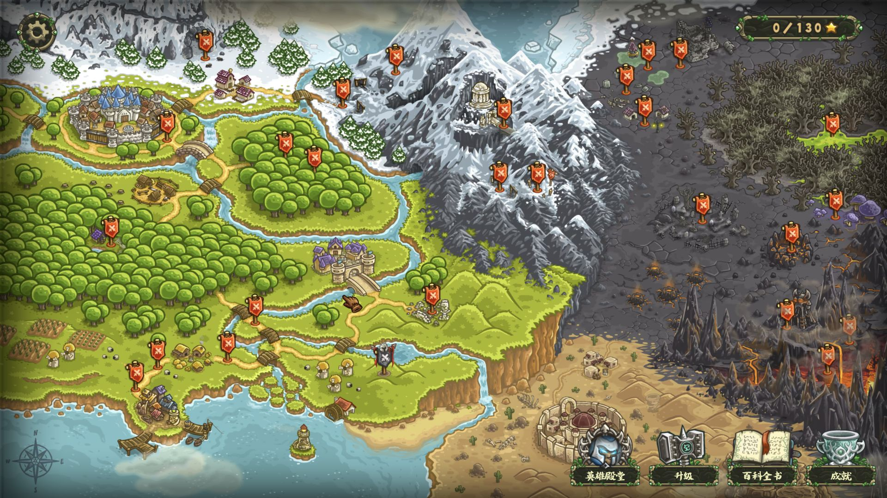
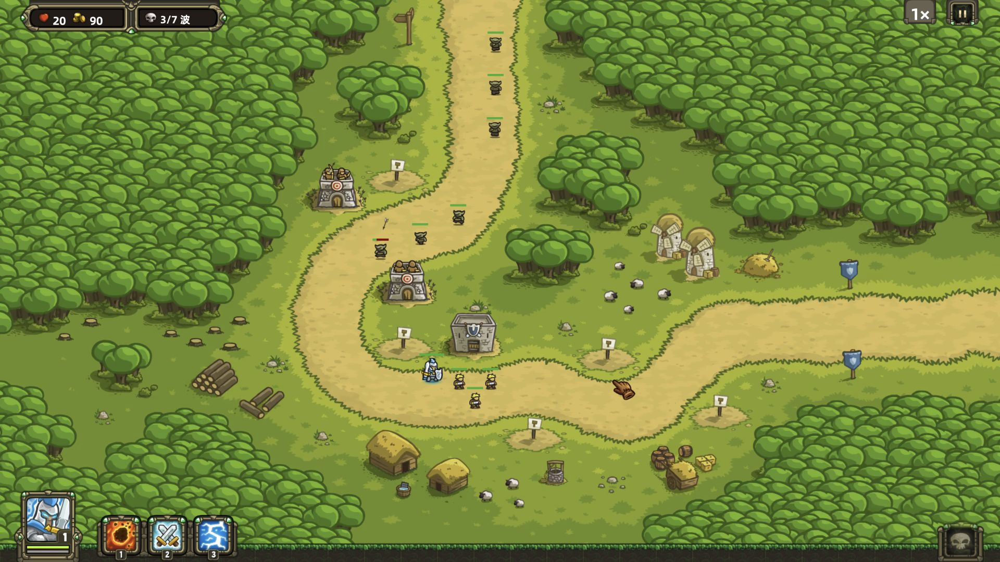
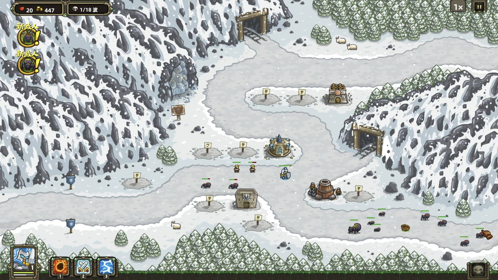
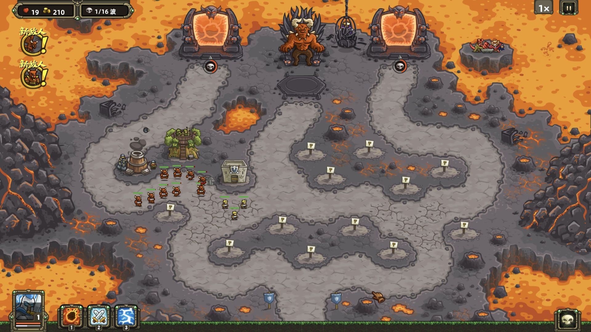
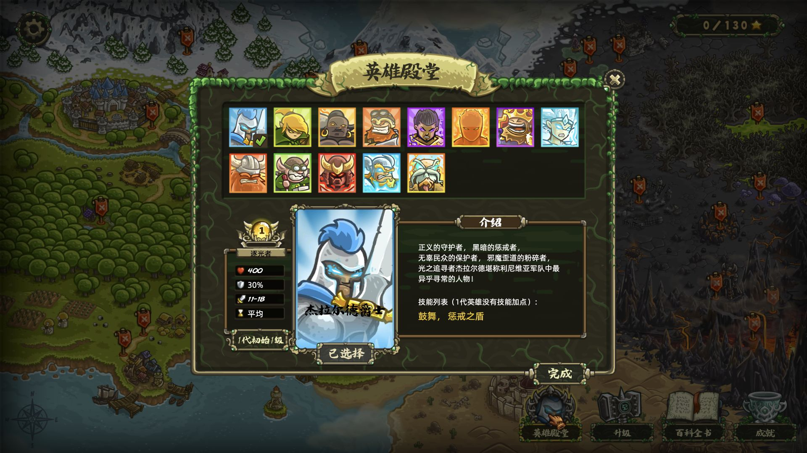

<div align="center">

# 王国保卫战 1 代 · JS 重写版

**Kingdom Rush · 在浏览器中重返初代战场**

TypeScript · PixiJS 8 · Vite · PWA

[快速启动](#快速启动) · [游戏截图](#游戏截图) · [操作指南](#操作指南) · [技术实现](#技术实现) · [深入分析](docs/TECHNICAL_IMPLEMENTATION.md) · [版权声明](#版权与免责声明)

</div>


用 JavaScript 技术栈重新实现《王国保卫战》初代的浏览器游戏。建造防御塔、指挥英雄、召唤援军，在草地、雪山与熔岩战场上阻挡一波波敌人。

项目使用 TypeScript 开发，构建后以 JavaScript 运行，围绕实时战斗、PixiJS 渲染、关卡资源加载和浏览器本地存档组织代码。

> **非官方学习与研究项目。** 本项目与原作开发商、发行商无隶属、合作或授权关系。原作名称、美术、音频及相关内容的权利归各自权利人所有。请支持正版，并阅读下方[版权与免责声明](#版权与免责声明)。

## 游戏内容

| 内容 | 当前实现 |
| --- | --- |
| 关卡与模式 | 26 个战役关卡的数据，战役、英雄挑战、钢铁挑战及无尽模式 |
| 防御塔 | 弓箭塔、兵营、法师塔、炮塔，以及塔升级与技能 |
| 英雄与战斗 | 13 位可选英雄、移动指挥、火雨、援军和闪电 |
| 成长与收集 | 星星升级、成就、英雄殿堂和百科界面 |
| 本地进度 | 3 个存档槽，保存关卡进度与游戏设置 |
| 显示与声音 | 多档渲染分辨率、显示模式、音乐和音效设置 |
| 安装与离线 | 生产版本支持 PWA 安装、版本更新及按需资源缓存 |

项目仍在持续开发。关卡数据收录不代表每项玩法都已完整复现，具体表现、数值和细节可能与原作不同。

## 技术实现

游戏使用 **TypeScript 编写规则、PixiJS 8 绘制画面、Vite 构建浏览器版本**。战斗状态与画面对象分开管理：模拟层负责移动、攻击、伤害和胜负，渲染层读取状态，更新精灵、动画和界面。

| 部分 | 实现方式 |
| --- | --- |
| 战斗循环 | 以固定 `1/60` 秒推进模拟，`requestAnimationFrame` 驱动画面；界面使用独立的表现时间，暂停时仍可播放菜单动画 |
| 移动与寻路 | 敌人按预设路线的累计距离前进；英雄移动使用地形网格与八方向 A* 寻路 |
| 攻击与技能 | 分开记录攻击前摇、命中时刻和冷却；结合弹道、护甲、范围判定和状态效果完成结算 |
| 画面与交互 | 使用纹理图集和序列帧动画；通过坐标转换、相机缩放与命中区域处理点击、拖动和双指缩放 |
| 数据与资源 | 关卡、英雄和界面由类型定义、JSON 数据及专门逻辑共同实现，进入场景时按需加载资源 |
| 存档与离线 | `localStorage` 按存档槽保存进度；生产版本用 Service Worker 缓存启动文件与已访问资源 |

想了解一座塔如何选敌、炮弹何时造成伤害、英雄如何绕路，以及大屏适配、音频和离线更新的具体处理，请阅读 **[技术实现深入分析](docs/TECHNICAL_IMPLEMENTATION.md)**。文档按当前源码展开，附有关键文件入口和实现边界。

## 游戏截图

以下为本仓库在浏览器中运行的 **1920 × 1080 实机截图**，包含世界地图、不同关卡与英雄界面。为展示不同场景，截图存档使用了游戏已有的“解锁全部关卡”选项。

### 世界地图



### 南港 · 草地防线



### 冰风隘口 · 雪地战场



### 万魔殿 · 熔岩战场



### 英雄殿堂



## 快速启动

本地使用 **Node.js 24** 与 **pnpm 11.0.9**。

```bash
git clone https://github.com/xyxiao001/kingdomRush.git
cd kingdomRush

# 安装项目指定版本的包管理器
npm install -g pnpm@11.0.9 --registry=https://registry.npmjs.org/

# 安装依赖并启动游戏
pnpm install
pnpm dev
```

打开 **http://127.0.0.1:5174/kr1/**，选择存档开始游戏。

项目的 `.npmrc` 使用 npm 官方源：

```ini
registry=https://registry.npmjs.org/
```

## 操作指南

1. **选择关卡**：在世界地图点击旗帜，选择模式并进入战场；拖动地图可移动视野。
2. **布置防御**：点击空地上的建造标记选择防御塔，点击已有防御塔进行升级或其他操作。
3. **指挥英雄**：选中英雄后点击目标位置移动；选中技能后点击战场目标施放。
4. **迎战敌人**：点击波次旗帜召唤敌人，合理安排防线并守住出口。

| 快捷键 | 功能 |
| --- | --- |
| `Space` | 战斗暂停 / 继续 |
| `Esc` | 关闭选择或弹窗，或打开暂停菜单，视当前界面而定 |
| `1` / `2` / `3` | 选择火雨 / 援军 / 闪电 |
| `4` | 选择英雄 |
| `Ctrl + F` / `⌘ + F` | 切换性能显示栏 |

英雄、技能与挑战模式受当前关卡和进度限制。地图设置中提供“解锁全部关卡”，便于直接体验不同场景；该选项不会替你取得通关星星。

## 构建与部署

```bash
pnpm build      # TypeScript 检查与生产构建
pnpm preview    # 本地预览生产版本
```

生产文件输出到 `dist/kr1/`，本地预览地址为 **http://127.0.0.1:5174/kr1/**。

当前基础路径为 `/kr1/`，配置位于 `games.config.ts`。部署时将 `dist/kr1/` 内的文件映射到站点的 `/kr1/` 路径；需要更换路径时，修改 `base` 并重新构建。GitHub 仓库仅托管源码，在线游戏需另行部署。

### 存档与离线使用

- 游戏进度保存在当前浏览器、当前站点的本地存储中，不会自动跨设备同步；清除站点数据会影响存档。
- PWA 在生产版本中启用，需要 HTTPS 或 localhost 环境；开发模式不启用离线缓存。
- 地图、关卡和英雄资源按访问需要缓存。离线前应先联网进入目标关卡并加载所用英雄，尚未加载的资源可能无法离线使用。

## 代码结构

```text
apps/kr1/
  src/                  游戏入口、战斗逻辑、渲染与交互
  public/               关卡、美术、音频等静态资源
packages/
  asset-runtime/        资源加载与缓存
  audio/                音频模块
  engine/               战斗与成长基础逻辑
  game-storage/         存档和设置
  game-types/           公共类型
  game-web/             浏览器界面与渲染组件
tools/build/            构建与 PWA 工具
docs/
  TECHNICAL_IMPLEMENTATION.md  技术实现深入分析
  screenshots/          实机截图
games.config.ts         基础路径、端口与存档版本配置
```

## 反馈问题

请通过 [GitHub Issues](https://github.com/xyxiao001/kingdomRush/issues) 提交问题，尽量附上关卡名称、游戏模式、浏览器版本、复现步骤和截图。

## 版权与免责声明

- **非官方项目**：本项目用于非商业的技术学习、研究与交流，不代表原作开发商或发行商，不暗示获得官方认可或授权。
- **原作权利归属**：《Kingdom Rush / 王国保卫战》的名称、商标、角色、美术、音乐、音效、剧情等内容，其权利归 Ironhide Game Studio 及相应权利人所有。仓库中的引用、资源及截图不会转移这些权利。
- **公开不等于授权**：仓库公开不代表原作素材获得开源授权，也不授予第三方内容的商业使用、再分发或其他许可。第三方依赖遵循各自许可条款，请支持正版游戏。
- **项目按现状提供**：不承诺功能完整、与原作完全一致或适用于特定用途，请自行保管重要存档。
- **侵权联系与删除**：如果你是相关权利人或其授权代表，认为仓库内的代码、资源、截图或说明侵犯权益，请通过 [GitHub Issues](https://github.com/xyxiao001/kingdomRush/issues) 说明涉及文件、权利依据和处理诉求。维护者将在核实后及时删除、替换相关内容，或按情况停止提供项目。

学习用途及上述声明不替代权利人的授权，也不免除依法应承担的责任。

感谢原作创作者，以及 TypeScript、PixiJS、Vite 等开源工具的维护者。
